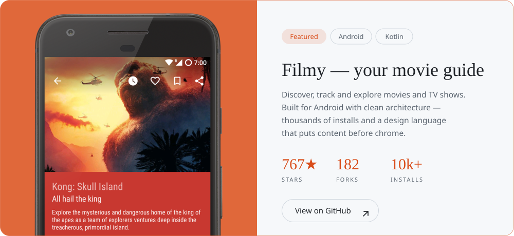
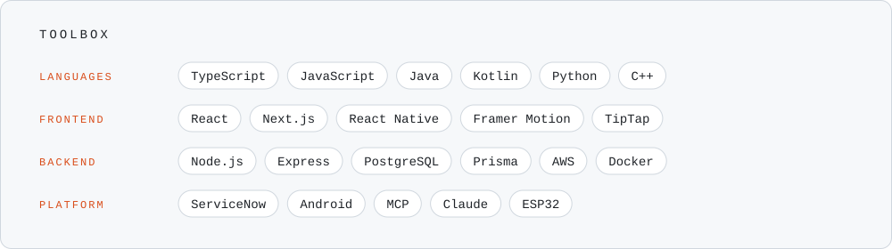
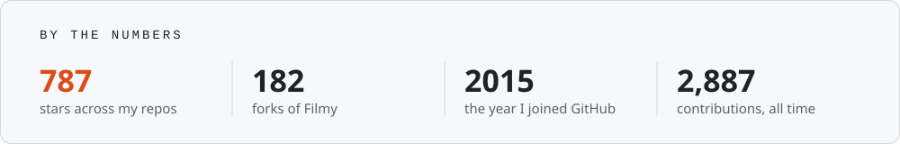

<picture><source media="(prefers-color-scheme: dark)" srcset="desk/desk-dark.svg"></picture>

## Hi there, I'm Sajal Gupta 👋 
Also known as **salroid**.

- 📍 Based in Hyderabad, India
- 💼 Staff Software Engineer at **ServiceNow**
- 🔧 I build apps and tools that make everyday life a little more interesting
- ✍️ I build, I design and I write, at [salroid.me](https://www.salroid.me)

<picture><source media="(prefers-color-scheme: dark)" srcset="desk/focus-dark.svg"></picture>

## 🔭 Spotlight

<a href="https://github.com/salRoid/Filmy"><picture><source media="(prefers-color-scheme: dark)" srcset="desk/project-Filmy-dark.svg"></picture></a>

## 🚀 Skills & tools

<picture><source media="(prefers-color-scheme: dark)" srcset="desk/skills-dark.svg"></picture>

## 🏆 GitHub highlights

<picture><source media="(prefers-color-scheme: dark)" srcset="desk/numbers-dark.svg"></picture>

## 📫 Get in touch

<a href="https://www.salroid.me"><picture><source media="(prefers-color-scheme: dark)" srcset="desk/contact-web-dark.svg"></picture></a> <a href="mailto:gupta.sajal631@gmail.com"><picture><source media="(prefers-color-scheme: dark)" srcset="desk/contact-mail-dark.svg"></picture></a> <a href="https://twitter.com/salRoid"><picture><source media="(prefers-color-scheme: dark)" srcset="desk/contact-x-dark.svg"></picture></a> <a href="https://www.instagram.com/sal_roid"><picture><source media="(prefers-color-scheme: dark)" srcset="desk/contact-instagram-dark.svg"></picture></a> <a href="https://www.linkedin.com/in/salroid"><picture><source media="(prefers-color-scheme: dark)" srcset="desk/contact-linkedin-dark.svg"></picture></a> <a href="https://www.youtube.com/@salroid"><picture><source media="(prefers-color-scheme: dark)" srcset="desk/contact-youtube-dark.svg"></picture></a>

Thanks for dropping by! 🚀
